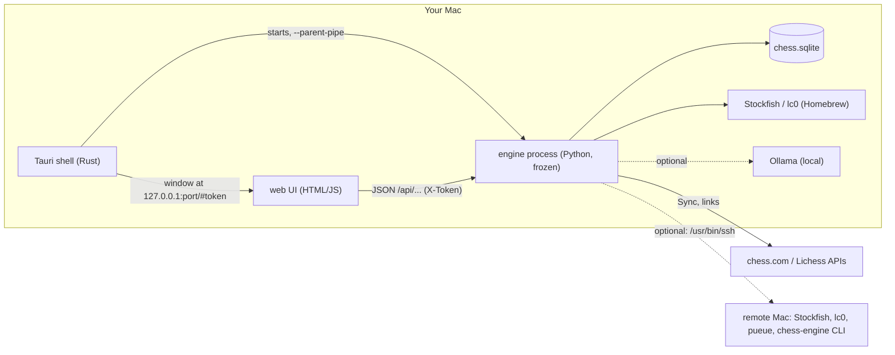

# Architecture

Three layers, one computer (two with the optional remote engine). Released for macOS;
Windows and Linux build from source, with every difference between systems in
`engine/system.py` and `main.rs`.

The remote-engine parts below (`remote.py`, `cli.py`, `batches.py`, the mini) live on
branch `feat/mini-offload`, on hold; `main` runs everything locally.

## Layers

**Shell** (`tauri/src-tauri/src/main.rs`). Starts the engine binary from the app
bundle (`Contents/Resources/engine/chess-engine`, or `engine/.venv` in dev) with
`--parent-pipe`, reads its first stdout line `LISTENING <port> <token>`, and opens
one window on `http://127.0.0.1:<port>/#<token>`. The engine exits when the shell's
pipe closes (`server._watch_parent`, which quits open engines first).

**Engine** (`engine/`, Python 3.11+, standard library + python-chess). A
`ThreadingHTTPServer` on 127.0.0.1 with a per-launch token (`X-Token` header;
the UI files are served without one). `server.py` is only the HTTP handler and
start-up; the routes live in `engine/routes/` (library, review, openings, insights,
training, coach), declared with `@route(method, regex)` from `api.py`, which also
holds `ApiError` and the shared workers (`api.ANALYSER`, `api.SYNCER`). Long work runs in background threads: the analysis queue
(`engines.Analyser`), Sync (`sync.Syncer`), the opening indexer
(`repertoire.INDEXER`), backups, and the patterns warm-up. Frozen with PyInstaller
`--onedir` by `tools/build_engine.py` (about 25 MB), which `tools/build_app.mjs`
(`npm run build`) runs before `tauri build`.

**Systems** (`engine/system.py`). Everything that differs between macOS, Windows
and Linux: the data folder, the downloads folder, extra folders searched for
engines (`CHESS_REVIEW_ENGINE_DIRS` overrides them; the UI test sets it empty to
fake a clean computer), revealing a folder, opening a link, low-priority engine
starts, and the install commands Setup shows (`setup()`, `install_hint()`).
`api.need_stockfish()` refuses Analyse with that command when Stockfish is missing.

**UI** (`web/`). No build step, no framework, nothing from the network. A hash
router (`route()` in `app.js`) calls `VIEWS[name](arg)`. One screen, one file:
`library.js`, `review.js`, `settings.js`, `setup.js` (Setup and the welcome),
`train.js`, `openings.js`, `insights.js`, `play.js`; `app.js` holds the shared
helpers (and `TIPS`/`showTip()`: the note each screen shows on a first visit,
remembered in the `tips_seen` setting), and `main.js`, loaded last, starts the app. Plain scripts share one
global scope, so a screen may use another's helpers. `board.js` is the SVG
board (drag and click moves, arrows, dots). Bundled font (Atkinson Hyperlegible
Next), 4 piece sets, 24 themes as CSS variables. **Follow Palette** (`engine/palette.py`,
`GET /api/palette`): when the `follow_palette` setting is on, the page asks every 2 s and lays
Palette's colours (from `~/.config/palette/current/chess-review.json`, checked: plain `#rrggbb`
only, 16 KB cap) over the closest built-in theme as inline CSS variables; move labels and
the board stay. A red/orange/yellow accent is swapped for the theme's blue, magenta or cyan.
`CHESS_REVIEW_PALETTE_DIR` overrides the folder (the tests use a fake one).

## Data on disk

`~/Library/Application Support/Chess Review/` on macOS, `%APPDATA%\Chess Review\` on
Windows, `~/.local/share/chess-review/` on Linux (`system.data_dir()`; `CHESS_REVIEW_DATA`
overrides it; the tests always set it):

- `chess.sqlite`: everything below.
- `backups/` (gzip SQLite, newest 10, weekly), `restore-pending.sqlite` (applied at the next start).
- `maia/`, `book/`, `engines/`: optional downloads (an engine unzipped into `engines/` is found). `batches/<id>/`: deep batches sent to a remote Mac.
- `engine.log`, `server.json` (port, token, pid).

Tables (each module creates its own with `CREATE TABLE IF NOT EXISTS`):

| Table | Module | Holds |
|---|---|---|
| `games` | store | PGN, players, ratings, time control, your side (`player_color`), `source` (chesscom / lichess / pgn / maia: played on Play, left out of Insights by `store.list_games(record_only=True)` / `all_reviews(record_only=True)`) |
| `reviews` | store | one zlib-compressed JSON review per game (raw engine data per ply), cached summary columns, `depth`, `engine`, `version`, `source` (local / remote-live / mini-batch), `host` |
| `settings`, `meta` | store | JSON key-values; meta holds versions, sync state, focus, scores |
| `game_notes`, `game_tags`, `deleted_games`, `variations`, `retries` | store | user data; deleted games are remembered so Sync skips them |
| `puzzles`, `puzzle_log`, `puzzle_scan` | store / puzzles | puzzles with their SM-2 schedule; scan per review version |
| `op_moves`, `op_games`, `repertoire`, `drill_log` | repertoire | opening tree index and the starred repertoire |
| `rep_lines`, `study_log`, `study_openings`, `explorer_cache` | study | line-by-line study state |
| `convert_drills`, `convert_log`, `convert_scan` | convert | convert-the-win drills |
| `pattern_cases` | patterns | per-game cache of recurring-mistake cases |
| `review_log` | plan | games opened in Review, for the weekly plan |
| `remote_batches` | batches | deep batches queued on a remote Mac |

Versions that trigger work: `GRADING_VERSION` (store: recompute cached label
counts), `ANALYSIS_VERSION` (chess_analysis: raw data format; older reviews show
"re-analyse"), `SCAN_VERSION` (puzzles: rescan, keeping schedules),
`INDEX_VERSION` (repertoire), `cli.SCHEMA_VERSION` (batch results).

## Main flows

**Analyse a game.** `POST /api/games/<id>/analyse` → `Analyser.enqueue` → worker
`_run`: picks the engine (`remote.stockfish()`), Maia, the book, then
`chess_analysis.analyze_game` walks every ply: Stockfish MultiPV 2 before and after
each move, threat probes (null move), Brilliant's capture search
(`sacrifice.sacrifice`), Maia's policy. The result (`GameReview` with `raw`
PlyData per ply) is saved by `store.save_review`. Reading a review
(`store.review_from_json`) re-runs `classify_review` with the current thresholds,
so labels are never stale.

**Review screen.** `GET /api/games/<id>` returns `payload.review_payload`: plies
with labels, verdict lines (`motifs`), best line and refutation, key moments, the
face-off summary and the clock analysis.

**Sync.** `sync.Syncer` reads chess.com monthly archives and the Lichess export
(NDJSON), applies the selective-sync filter (period, time controls, opponent
rating), skips deleted games, adds new ones. Then (remote engine on) it imports
finished deep batches (`batches.import_all`).

**Puzzles.** `puzzles.scan()` turns each review's errors (yours and, optionally,
your opponent's) into puzzles; `queue()` builds today's list; `record()` schedules
them. Grading a try is `/api/grade` (a short Stockfish check). Rules: `docs/GRADING.md`.

**Openings.** `repertoire.INDEXER` indexes every game's first moves into a tree;
you star moves (or "build from my games"); `theory.learn` adds a named opening
from `engine/data/theory.json`; `study` turns the repertoire into lines with a
spaced-repetition ladder.

**Board and coach.** `live.Live` keeps one engine thinking on the current FEN
(MultiPV 3, stops when nobody polls). `coach.facts` combines Stockfish, position
features (`features.py`), threats both ways and Maia; Ollama (optional) words them
(`/api/chat` on 127.0.0.1:11434).

**Remote engine** (branch `feat/mini-offload`). `remote.py` builds
`/usr/bin/ssh -T -o BatchMode=yes -o ConnectTimeout=5 <host> <cmd>` and checks
health (`uci`/`uciok` in 8 s). Every engine start goes through it; failures fall
back to local with a notice (`remote.notice()`). `cli.py` is the same frozen
binary run as `chess-engine analyze` (JSONL out, resumable). `batches.py` exports
PGN chunks of 10, copies the CLI and the batch with tar over ssh, queues one
`pueue` task per chunk, and imports results on Sync (deeper only).

## Testing

- `engine/selftest.py`: the analysis core on fixed positions, the store, sync with
  fake HTTP, puzzles, openings, insights, coach facts, V8 features, the remote
  engine with `engine/tests/fake_ssh.py` and `engine/tests/fakebin/pueue`, then the
  HTTP API against a real server process. Temp data folder; one-thread Stockfish.
- `tools/ui_test.py`: Playwright drives every screen of a throwaway server, saves
  screenshots, fails on any JS error. It ends by starting the app as a clean computer
  (empty data folder, no engines on the path) to check the first-run screens.
- `engine/tests/sample_games.pgn`: three public-domain master games (1851, 1858,
  1956) played by a made-up `TestPlayer`; the third has made-up 10+0 clocks and a
  chess.com-style link.

## Weak spots

- CI (`.github/workflows/ci.yml`): both checks on a macOS runner, and build-only jobs on
  macOS, Ubuntu and Windows. Windows and Linux builds are only checked to build, not used.
- The Lichess explorer needs a personal token since 2025 (HTTP 401 without).
- Analysis is the slow part: MultiPV 2 at your moves (needed for Great and for
  puzzles) adds about 30%, and threat probes add more (they can be turned off).
- Win chance saturates near mate: any rule comparing win chances must handle mates
  separately (the 2026-10-05 puzzle bug).
- The remote engine hasn't run against a real Mac mini yet.

## Glossary

- **Win chance / points**: Lichess's mapping from centipawns to 0-100%
  (`chess_analysis.win_percent`); a "point" is one percentage point of it.
- **Ply**: one half-move. **MultiPV**: the engine reports its best N lines.
- **Maia**: neural nets (run by lc0) trained to predict human moves at a rating band.
- **Threat probe**: give a side a free move (null move) and see what it would win.
- **pueue**: a command-line job queue on the remote Mac; a "group" runs N jobs in parallel.
